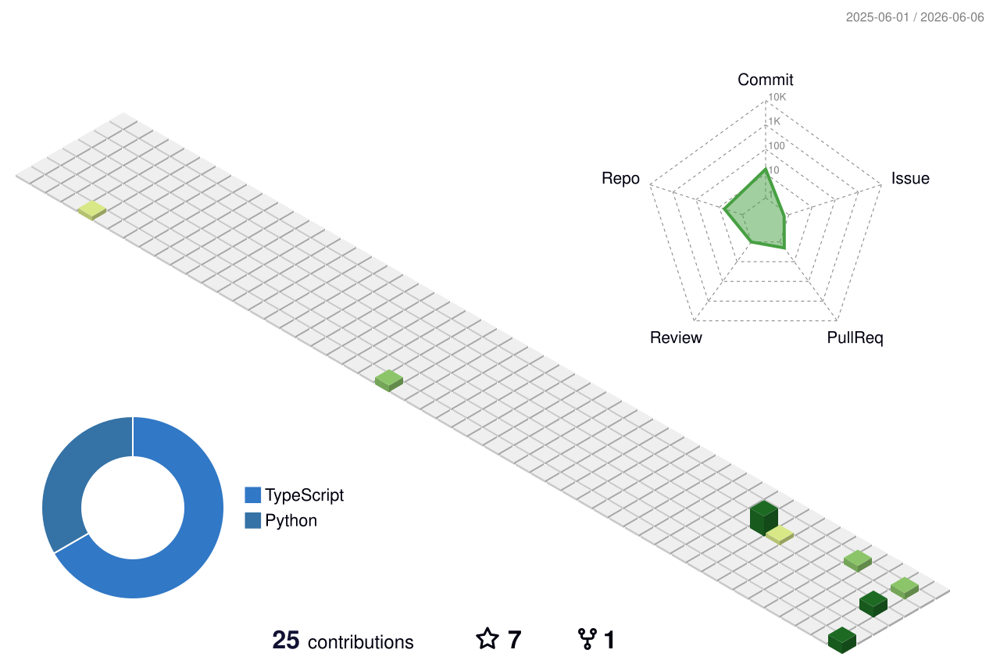

<div align="center">

# Gustavo Barbosa

Fullstack Developer — Rio Grande do Sul, Brazil

[](mailto:gustavobarbosa.net@gmail.com)
[]()

</div>

<br>

```ts
const gustavo = {
  role: "Fullstack Developer",
  focus: ["backend architecture", "data analysis", "game logic"],
  principle: "turn complex logic into systems that are simple to reason about",
  currently: "shipping and refining personal projects",
};
```

<br>

## Stack

<div align="center">
  
</div>

## Projects

<!-- PROJECTS:START -->
_No public repositories to list yet._
<!-- PROJECTS:END -->

## Metrics

<table align="center">
  <tr>
    <td>
      
    </td>
    <td>
      
    </td>
  </tr>
</table>

<div align="center">
  
</div>

## Activity

<div align="center">
  
</div>

<div align="center">
  <picture>
    <source media="(prefers-color-scheme: dark)" srcset="dist/github-snake-dark.svg">
    <source media="(prefers-color-scheme: light)" srcset="dist/github-snake-dark.svg">
    
  </picture>
</div>
